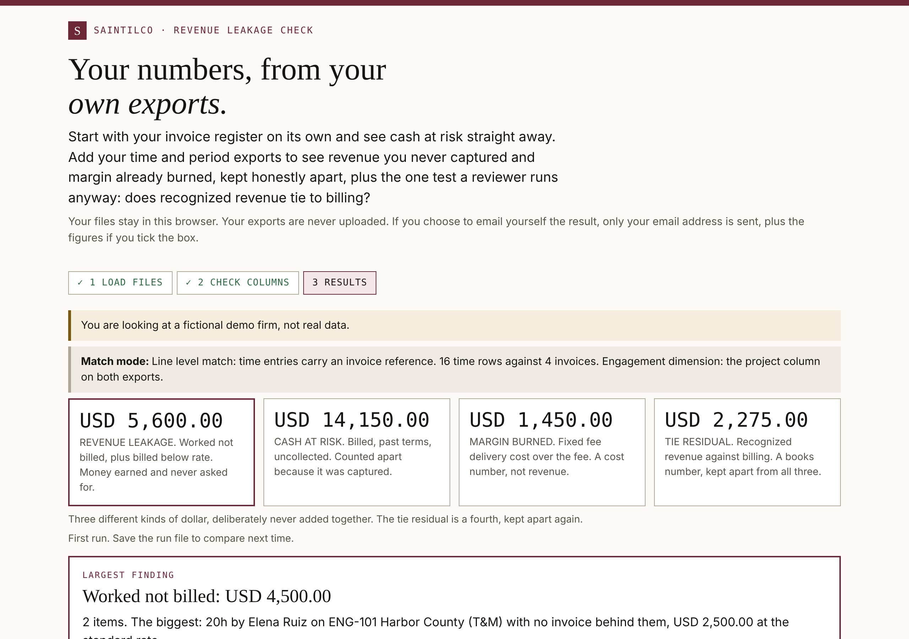

# Revenue Leakage Check

**Free. Runs in your browser. Your files are never uploaded.**

**Run it:** https://saintilco.com/revenue-leakage-check.html

For professional services firms. Load your invoice register and see cash at risk straight away. Add your time export and period summary to see revenue you never captured and margin already burned, plus the one test a reviewer runs anyway: does recognized revenue tie to billing?

Four kinds of dollar figure, kept apart and never added together:

| Figure | What it means |
|---|---|
| Revenue leakage | Work done but not billed, plus work billed below rate |
| Cash at risk | Billed, past terms, uncollected |
| Margin burned | Fixed-fee delivery cost over the fee. A cost number, not revenue |
| Tie residual | Recognized revenue against billing. A books number, kept apart from all three |

## Try it with the sample files

`samples/` holds the four exports of a fictional firm, the same data behind the "Try it with the demo firm" button:

| File | What it is |
|---|---|
| `sample_invoice_register.csv` | 4 invoices |
| `sample_time_entries.csv` | 16 time rows |
| `sample_period_summary.csv` | One quarter: recognized, billed, unbilled and deferred movement |
| `sample_engagement_list.csv` | 3 engagements, one T&M and two fixed fee |

Load them on the page with the as-of date 2026-09-28. You should see USD 5,600.00 revenue leakage, USD 14,150.00 cash at risk, USD 1,450.00 margin burned and USD 2,275.00 tie residual.

If you load only some files, the checks that need the missing ones show **Not run**, never zero, on screen, in print and in the screen-reader announcement.

## How it is tested

- **Automated engine tests, every build:** 40 tests on the engine and 11 tests that hold the page's claims to what the engine actually does.
- **Browser check, every build:** Chrome at desktop and phone width runs the demo and fixture files end to end, prints the summary, and fails the build if a print is blank, if a check that did not run shows as USD 0.00 or "no leakage found", or if the screen-reader announcement reports a figure that was not checked.
- **Independent QA before release:** a separate QA lead retests every release candidate on made-up data. The live build, 2026-11-11.2 (engine 0.2.1, rules 0.1.2), passed on 11 November 2026. The build number is printed in the page footer.
- **Not yet covered:** Safari, Firefox, Windows, real Excel and Google Sheets exports, and a full accessibility audit.

The check reports what your exports show. It does not test whether the work happened, and it is not an audit.

## What this repository is

A showcase: what the tool does, what it looks like, made-up sample files to try it with, and how it is checked. The tool itself runs on saintilco.com. **No source code, test suites or answer keys are published here.**

Everything in `samples/` is fictional. No client data, real names or real figures appear anywhere in this repository.

## About

Built by [Saintilco Consulting](https://saintilco.com), independent Workday Financials controls reviews. Saintilco Consulting is not affiliated with, sponsored by, or endorsed by Workday, Inc. WORKDAY is a trademark of Workday, Inc. Commercial and systems guidance only, not legal, tax, accounting or audit advice.

Copyright 2026 Saintilco Consulting. All rights reserved. No license is granted to copy, modify or redistribute the tool or this material.
